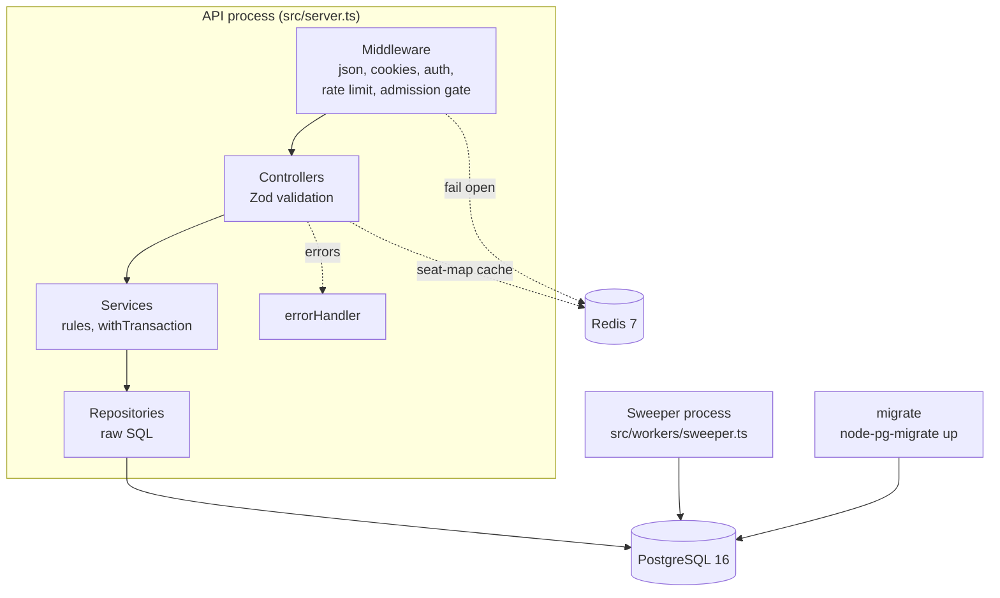
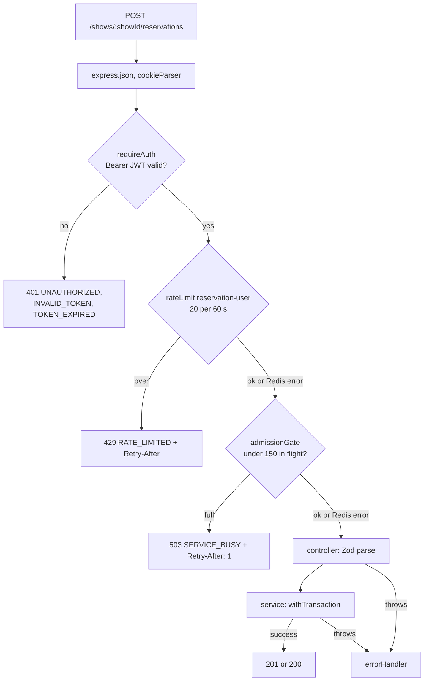

# Architecture

This page covers the components, the processes they run in, the path a request takes
through the middleware, and what the API does when Postgres or Redis misbehave.

## Components

| Component | Owns | Code |
|---|---|---|
| PostgreSQL | All state: users, tokens, venues, events, shows, seats, holds, bookings, tickets. Expiry is evaluated with its `now()`. Constraints are the final guard. | `migrations/` |
| API | HTTP, validation, business rules, transactions. Stateless: no in-process state affects correctness. | `src/app.ts`, `src/modules/*` |
| Redis | Advisory only: rate-limit counters, the admission gate's in-flight set, the seat-map cache. Every use fails open. | `src/redis/client.ts`, `src/middleware/rateLimit.ts`, `src/middleware/admissionControl.ts`, `src/modules/show-seats/show-seats.controller.ts` |
| Sweeper | Periodic cleanup of expired reservations, bookings and seat holds. Never needed for correctness. | `src/workers/sweeper.ts`, `src/modules/sweeper/` |
| migrate | Applies `migrations/*.sql` once and exits. | `npm run migrate:up` |

Each module in `src/modules/` follows the same layering: `*.routes.ts` (paths and
middleware), `*.controller.ts` (parse input with Zod, call the service, pick the status
code), `*.service.ts` (rules, transactions, error translation), `*.repository.ts` (SQL with
`$n` placeholders only), `*.schema.ts` (Zod schemas).

## Process model

All three app services use the same image (`flashseat-app:local`, built from `Dockerfile`)
and the same `env_file: .env.docker`. `docker-compose.yml` sets `DATABASE_URL` and
`REDIS_URL` to the compose service names.

| Service | Command | Restart | Starts after | Postgres `application_name` |
|---|---|---|---|---|
| `postgres` | `postgres:16` image | default | – | – |
| `redis` | `redis:7-alpine` image | default | – | – |
| `migrate` | `npm run migrate:up` | `"no"` | postgres healthy | – |
| `api` | `node dist/server.js` | `unless-stopped` | postgres and redis healthy, migrate exited 0 | `flashseat-api` |
| `sweeper` | `node dist/workers/sweeper.js` | `unless-stopped` | same as api | `flashseat-sweeper` |

- The API's health check runs `fetch('http://127.0.0.1:3000/health')` inside the container
  every 10 s, because `node:22-slim` has no curl.
- `api` and `sweeper` have `stop_grace_period: 15s`, which is longer than
  `SHUTDOWN_TIMEOUT_MS` (10 s), so the shutdown handlers finish before Docker sends SIGKILL.
- The sweeper sets its `application_name` in `src/workers/set-app-name.ts` before anything
  reads the env. Tests run with `flashseat-test` (`vitest.config.ts`), so killing
  `flashseat-api` backends in tests never hits the test process's own connections.
- Each process has its own pool of `DB_POOL_MAX` (10) connections.
- Several API instances can share one database and one Redis. Holds, expiry, idempotency and
  locking live in Postgres, and the admission gate reads time from Redis `TIME`. Several
  sweepers can also run at once: `SKIP LOCKED` gives each row to exactly one of them
  ([lock-order.md](lock-order.md#sweeper)).

## Request lifecycle

The order is fixed by `src/app.ts` and each router. A hold request goes through every layer:

| Layer | Applied to | Behaviour |
|---|---|---|
| `express.json()` | all | parses JSON bodies (Express default 100 kb limit) |
| `cookieParser()` | all | reads the `refreshToken` cookie for `/auth/refresh` and `/auth/logout` |
| `requireAuth` | every route except `/auth/*`, `GET /events`, `GET /events/:eventId`, `GET /events/:eventId/shows/:showId`, `GET /shows/:showId/seats`, `/health` | verifies the HS256 JWT on the app clock with 5 s tolerance and validates the payload (`userId` uuid, `role` enum). No DB lookup. |
| `requireRole('ORGANIZER')` | venues, event writes, `GET /events/mine`, show creation | 403 `FORBIDDEN` for other roles |
| `rateLimit` | `POST /auth/register` (per IP), `POST /auth/login` (per IP, then per email), `POST /shows/:showId/reservations` (per user) | fixed window; 429 `RATE_LIMITED` with `Retry-After` set to the key's TTL; skipped when `ENABLE_RATE_LIMITING=false` |
| `admissionGate` | hold, checkout, confirm-mock | caps in-flight requests across all API instances; 503 `SERVICE_BUSY` |
| controller | – | Zod parse of params, query, body and headers; a `ZodError` becomes 400 `VALIDATION_ERROR` with `details` |
| service | – | one `withTransaction` per write; throws `AppError` subclasses with a stable `code` |
| `errorHandler` | last middleware | one response shape: `{ "error": { "message", "code", "details"? } }` |

### Admission gate

`src/middleware/admissionControl.ts` keeps one Redis sorted set,
`admission:inflight:booking:set`. Every admitted request is a member (a random UUID) scored
with Redis server time. One Lua script does all of this atomically:

1. Remove members older than `INFLIGHT_SAFETY_TTL_SECONDS` (10 s).
2. Count the members that are left.
3. If the count is below `MAX_INFLIGHT_BOOKING_REQUESTS`, add this request.

The member is removed (`ZREM`) on the response's `finish` or `close` event. A release that
is lost because Redis timed out can therefore cost one slot for at most 10 s, even under
constant traffic. That is why the gate uses a sorted set instead of an `INCR`/`DECR`
counter: a counter could leak a slot forever. A timed-out increment replayed after a Redis
reconnect left the count one too high, and steady traffic kept refreshing its TTL. This
was found by the test battery against the Docker stack and fixed in commit `1221013`. The
limit of 150 comes from the peak goodput of the [baseline throughput test](../load/RESULTS.md#run-2-db_pool_max10-baseline),
~390 transactions/s on 10 connections: 150/390 ≈ 385 ms of queueing for the last request
admitted. The code
comment calls it "a guess informed by that number, not a measured optimum".

### Seat-map cache

`GET /shows/:showId/seats` reads `seatmap:<showId>` from Redis. On a miss it queries
Postgres and writes the result with a `SEAT_MAP_CACHE_TTL_MS` (2000 ms) expiry. The
`X-Cache: HIT|MISS` header shows which happened. The seat map is advisory, and a cached copy
can be up to 2 s stale in either direction:

- **A taken seat shows as available.** A hold on it re-checks the seat under its row lock and
  gets 409 `SEATS_UNAVAILABLE`.
- **A just-freed seat shows as held.** It appears as available once the cached copy expires,
  within 2 s.

Neither case can oversell, because every hold decides availability in Postgres under the
row lock, never from the cache.

## Failure behaviour

Postgres guards are set per connection in `src/db/pool.ts`: `connectionTimeoutMillis`,
`statement_timeout`, `lock_timeout` and `idle_in_transaction_session_timeout`. Errors are
mapped in `src/middleware/errorHandler.ts`, keyed on SQLSTATE. SQL text and constraint names
go to the logs only, never into the response.

| Situation | What happens | HTTP |
|---|---|---|
| Pool exhausted: no connection within `DB_CONNECTION_TIMEOUT_MS` (5 s) | pg rejects with "timeout exceeded when trying to connect" | 503 `DB_UNAVAILABLE`, `Retry-After: 1` |
| Postgres down, restarting, or backend killed (`08xxx`, `ECONNREFUSED`, `ECONNRESET`, `ETIMEDOUT`, `57P01`, `57P03`, "Connection terminated") | request fails; if `ROLLBACK` also fails, the client is destroyed instead of returned to the pool | 503 `DB_UNAVAILABLE`, `Retry-After: 1` |
| An idle pooled connection dies | `pool.on('error')` and a per-client `error` listener log it; the process stays up | – |
| Statement longer than `DB_STATEMENT_TIMEOUT_MS` (5 s), `57014` | Postgres cancels the statement | 503 `DB_TIMEOUT`, `Retry-After: 1` |
| Row-lock wait longer than `DB_LOCK_TIMEOUT_MS` (1 s), `55P03` | the waiting statement fails | 409 `LOCK_TIMEOUT`, `Retry-After: 1` |
| Deadlock or serialization failure (`40P01`, `40001`) | Postgres aborts one transaction | 409 `RETRYABLE_CONFLICT`, `Retry-After: 1` |
| Transaction idle longer than `DB_IDLE_IN_TX_TIMEOUT_MS` (10 s) | Postgres kills the session; the next query on it is a connection error | 503 `DB_UNAVAILABLE` |
| Unmapped `23505` / `23P01` / `23503` | services translate the constraints they expect first (for example `EMAIL_TAKEN`, `ACTIVE_RESERVATION_EXISTS`); anything left is generic | 409 `CONFLICT` |
| `23514`, `22P02`, `22001`, `22003` | bad value reached SQL | 400 `VALIDATION_ERROR` |
| Redis down, slow or disconnected | commands are rejected at once while disconnected (`enableOfflineQueue: false`) or time out after 2 s (`commandTimeout`); rate limiter and gate let the request through, cache falls through to Postgres; a warning is logged | none (request proceeds) |
| Admission gate full | rejected before any DB work | 503 `SERVICE_BUSY`, `Retry-After: 1` |
| Rate limit exceeded | rejected before any DB work | 429 `RATE_LIMITED`, `Retry-After: <seconds>` |
| Shutting down (SIGTERM/SIGINT) | `/health` reports draining; in-flight requests finish | 503 `SHUTTING_DOWN` on `/health` |
| Anything else | full error logged | 500 `INTERNAL` |

The `commandTimeout` is 2000 ms, not lower, for a measured reason. In the first load test
with the Redis gate, a 250 ms timeout was shorter than the event-loop lag at 10,000
concurrent requests (up to 1.7 s). Nearly every Redis check failed open and the gate never
fired (`src/redis/client.ts` comment; [load/RESULTS.md](../load/RESULTS.md#implementation-bugs-this-re-run-exposed-fixed-before-the-numbers-below),
attempt 1).

### Graceful shutdown

`src/server.ts`, on SIGTERM or SIGINT:

1. Sets `lifecycle.shuttingDown`, so `/health` returns 503 and a load balancer stops
   sending traffic.
2. Closes idle keep-alive connections and stops accepting new ones (`server.close`).
3. After in-flight requests finish, ends the pg pool and quits Redis, then exits 0.
4. If draining takes longer than `SHUTDOWN_TIMEOUT_MS` (10 s), it force-closes all
   connections and exits 1.

`unhandledRejection` and `uncaughtException` run the same path with exit code 1. The
sweeper (`src/workers/sweeper.ts`) stops its timer, waits for a running sweep (also bounded
by `SHUTDOWN_TIMEOUT_MS`), ends its pool and exits 0.

## Related

- [booking-flow.md](booking-flow.md): what each booking transaction does
- [lock-order.md](lock-order.md): the lock hierarchy every transaction follows
- [clocks.md](clocks.md): DB clock vs app clock
- [operations.md](operations.md): env vars, logs, troubleshooting
