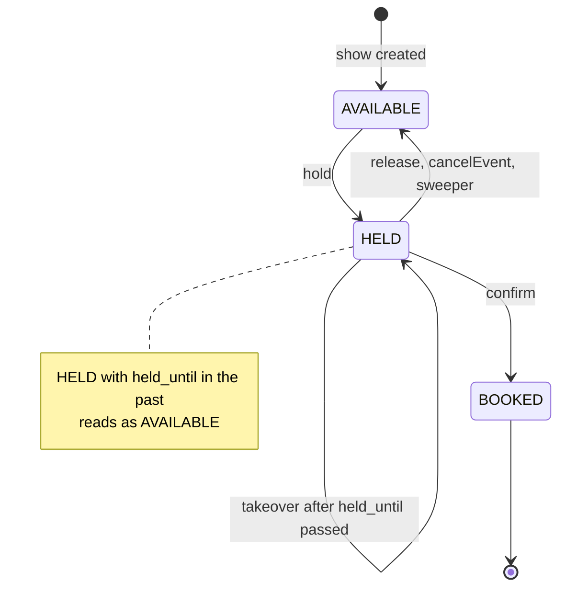
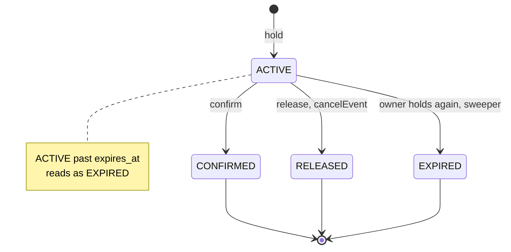
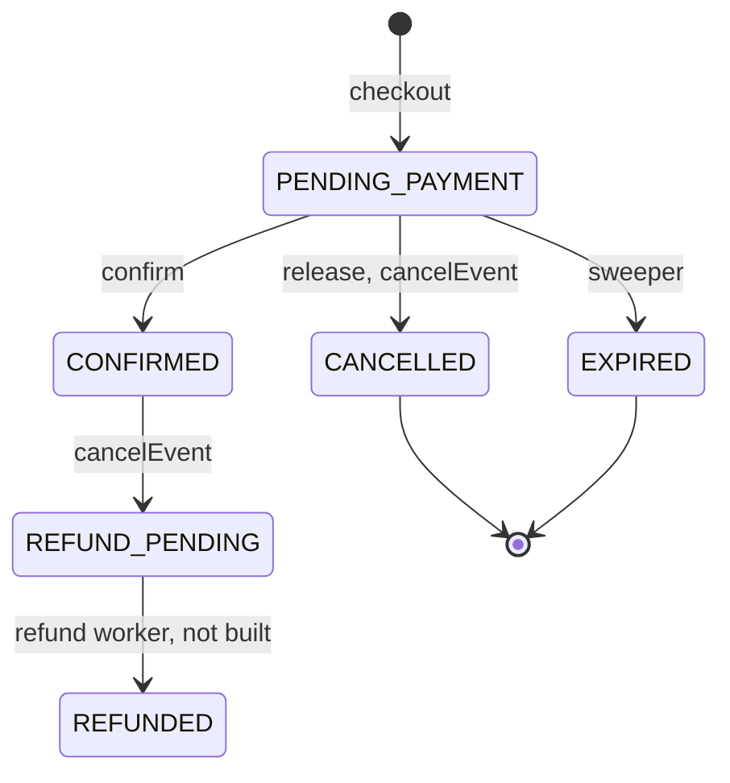
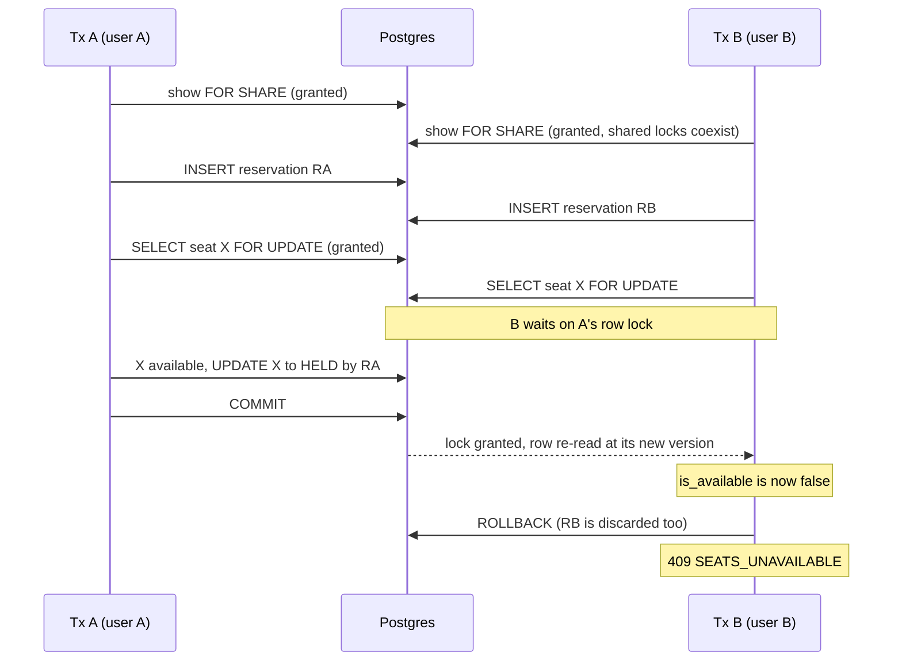

# Booking flow

How a seat goes from available to ticketed, and what stops two users from getting the same
seat. Every step below is one Postgres transaction (`withTransaction` in `src/db/pool.ts`).
Each transaction takes row locks in the global order from [lock-order.md](lock-order.md):

> event, then the venue advisory lock, then show, reservation, booking, and `show_seats`
> (ascending id)

All "has it expired" and "has the show started" checks use Postgres `now()`, never the app
server's clock ([clocks.md](clocks.md)).

Code: `src/modules/reservations/reservations.service.ts` (hold, release),
`src/modules/bookings/bookings.service.ts` (checkout, confirm),
`src/modules/events/events.service.ts` (cancelEvent).

## Hold: `POST /shows/:showId/reservations`

Request: header `Idempotency-Key` (8–128 printable ASCII characters), body
`{ "seatIds": [uuid, ...] }` with 1 to `MAX_SEATS_PER_RESERVATION` (6) distinct ids. Ids are
lowercased before any comparison. The route runs `requireAuth`, the per-user rate limiter and
the admission gate first.

1. **Idempotency check.** Look up `(user_id, idempotency_key)`. If a reservation exists, run
   the [replay rules](#idempotency-and-replay-rules) and stop.
2. **Lock the show `FOR SHARE`** and read its status, its event's status, `starts_at > now()`
   and `sales_open_at <= now()` (or null). If the show is missing or its event is DRAFT,
   return 404. If the show is not SCHEDULED, the event not PUBLISHED, the show already
   started or sales not open, return 409 `SHOW_NOT_BOOKABLE`. `FOR SHARE` lets any number of
   holds run on the same show at once, but blocks `cancelEvent`, which needs `FOR UPDATE`.
3. **Expire the user's own stale holds** for this show:
   `UPDATE reservations SET status='EXPIRED' WHERE ... status='ACTIVE' AND expires_at <= now()`.
   This step only touches reservations; leftover HELD seats are free by the lazy rule below.
4. **Insert the reservation** with `expires_at = now() + HOLD_DURATION_SECONDS` and
   `ON CONFLICT (user_id, idempotency_key) DO NOTHING`, inside a savepoint.
   - If `uq_one_active_reservation` fires (the user already has an ACTIVE hold on this
     show), roll back to the savepoint and re-read by key up to 3 times, 20 ms apart. If the
     key is found, it was a concurrent twin of this same request: replay it. If not, return
     409 `ACTIVE_RESERVATION_EXISTS`.
   - If `ON CONFLICT` swallowed the insert, a concurrent same-key request committed first:
     re-read and replay it.
5. **Lock the seats**:
   `SELECT ... FROM show_seats WHERE show_id=$1 AND id = ANY($2) ORDER BY id FOR UPDATE`.
   If fewer rows come back than ids were sent, some seats belong to another show: 400.
6. **Check availability under the lock.** A seat is available if it is `AVAILABLE`, or
   `HELD` with `held_until < now()` (an expired hold can be taken over). If any seat is not
   available, return 409 `SEATS_UNAVAILABLE` with `details.unavailableSeatIds`. The whole
   transaction rolls back, including the reservation row.
7. **Hold**: set the seats `HELD`, with `reservation_id` set and `held_until` equal to the
   reservation's `expires_at`. Insert `reservation_seats` rows.
8. Commit. Return 201 with the reservation, its seats in row order and the total price.

## Checkout: `POST /reservations/:reservationId/checkout`

Creates the booking that payment will confirm. No tickets are created here.

1. Plain (non-locking) read of the reservation's `show_id`, filtered by owner. Not found or
   not yours: 404.
2. Lock the show `FOR SHARE`. Missing show or DRAFT event: 404.
3. Lock the reservation `FOR UPDATE`.
4. Lock its booking (if any) `FOR UPDATE`. If a booking already exists, this is a replay:
   - CONFIRMED: return it with 200.
   - PENDING_PAYMENT and the hold is still live: return it with 200.
   - PENDING_PAYMENT and the hold is dead: 409 `RESERVATION_NOT_ACTIVE`.
   - Any other status: 409 `BOOKING_NOT_PAYABLE` with `details.status`.
5. The reservation must be ACTIVE with `expires_at > now()`, else 409
   `RESERVATION_NOT_ACTIVE` ("has been released" or "has expired").
6. The show must be SCHEDULED, its event PUBLISHED, and not started, else 409
   `SHOW_NOT_BOOKABLE`.
7. Lock the reservation's seats `ORDER BY id FOR UPDATE`. Every seat must still be `HELD` by
   this reservation with `held_until > now()`, and the count must match `reservation_seats`.
   Otherwise 409 `HOLD_LOST` (someone took over an expired hold).
8. Insert the booking: `PENDING_PAYMENT`, total = sum of seat prices. Return 201 with
   `payBefore` = the reservation's `expires_at`.

`bookings.reservation_id` is `UNIQUE`, and step 4 runs under the reservation lock, so ten
parallel checkouts of one reservation give one 201 and nine 200 replays of the same booking
(`tests/concurrency.test.ts`).

## Confirm: `POST /bookings/:bookingId/confirm-mock`

Returns 404 `Endpoint not available` unless `ENABLE_MOCK_PAYMENT=true`, and 404 if the
booking is not the caller's. The owner check is in `confirmMockBooking`; the rest is
`confirmBookingCore`, which the planned payment webhook is meant to call.

1. Plain read of the booking's `show_id` and `reservation_id`.
2. Lock the show `FOR SHARE`.
3. Lock the reservation, then the booking, both `FOR UPDATE`.
4. Already CONFIRMED: return it with 200 (replay). This is checked before the show check, so
   a retry of a confirmed booking never fails after the fact.
5. The show must still be bookable, else 409 `SHOW_NOT_BOOKABLE`. A code comment notes that
   when the planned payment webhook gets this error after money was captured, it must
   trigger a refund.
6. The booking must be PENDING_PAYMENT, else 409 `BOOKING_NOT_PAYABLE`. The reservation must
   be ACTIVE with `expires_at > now()`, else 409 `HOLD_LOST`.
7. Lock the seats `ORDER BY id FOR UPDATE`; the same check as checkout step 7 applies.
8. Set the seats `BOOKED` with `booking_id`. Insert one `booking_seats` row per seat, each
   with its own `ticket_code`. If the ticket price sum doesn't equal the booking total, throw
   (the transaction rolls back).
9. Set the booking `CONFIRMED` (`confirmed_at = now()`) and the reservation `CONFIRMED`.
   Return 200 with `ticketCode` on each seat.

If `uq_one_live_ticket_per_seat` ever fires here, it is logged as
`CRITICAL INVARIANT VIOLATION` and the request fails. Every earlier layer would have to be
wrong for that to happen.

## Release: `DELETE /reservations/:reservationId`

1. Plain read of `show_id` with the owner check (404).
2. Lock the show `FOR SHARE`, only to respect the hierarchy; release works on any show.
3. Lock the reservation, then its booking, `FOR UPDATE`.
4. CONFIRMED: 409 `CANNOT_RELEASE_CONFIRMED`. RELEASED or EXPIRED: 204 (idempotent, nothing
   changes).
5. ACTIVE: lock its HELD seats `ORDER BY id FOR UPDATE`, set them `AVAILABLE`, mark the
   reservation `RELEASED`, and cancel a `PENDING_PAYMENT` booking (`CANCELLED`). Return 204.

Freeing seats filters on `reservation_id = $1 AND status = 'HELD'`, so a seat another user
has since taken over is never touched.

## Cancel event: `POST /events/:eventId/cancel`

One transaction, set-based statements, every level locked in ascending id order:

1. Lock the event `FOR UPDATE`, filtered by organizer (404 if not yours). Already CANCELLED:
   return 200 and change nothing.
2. Lock the event's shows `ORDER BY id FOR UPDATE`; set them `CANCELLED`.
3. Lock ACTIVE reservations, then PENDING_PAYMENT and CONFIRMED bookings, then HELD seats,
   each `ORDER BY id FOR UPDATE`.
4. HELD seats become `AVAILABLE`; ACTIVE reservations become `RELEASED`; PENDING_PAYMENT
   bookings become `CANCELLED`; CONFIRMED bookings become `REFUND_PENDING`. Their seats stay
   `BOOKED` and their tickets stay live until a refund worker (not built yet) releases them.
5. Set the event `CANCELLED` with `cancelled_at = now()`.

The show lock is `FOR UPDATE` here and `FOR SHARE` in every booking path, so cancellation
waits for in-flight holds, checkouts and confirms on that show, and they wait for it. After
it commits, they see the show as not bookable. Publishing a cancelled event is refused
(only DRAFT can be published), and so are creating shows on it and editing it (409
`EVENT_CANCELLED`).

## Lazy expiry and the sweeper

A hold's deadline is data, not a timer:

- **Availability** treats `HELD` with `held_until < now()` as free: the seat map shows it
  `AVAILABLE`, and a new hold can take it over.
- **Reads** of a reservation report `EXPIRED` when it is `ACTIVE` past `expires_at`. Reads of
  a booking report `EXPIRED` (and drop `payBefore`) when it is `PENDING_PAYMENT` and its
  reservation is no longer live.
- **Writes** (checkout, confirm) check `expires_at > now()` and `held_until > now()` under
  their locks.

So correctness never waits for cleanup. The sweeper (`src/workers/sweeper.ts`, every
`SWEEPER_INTERVAL_MS`, 15 s) makes the stored rows match: expired ACTIVE reservations become
`EXPIRED`, their `PENDING_PAYMENT` bookings become `EXPIRED`, and expired HELD seats become
`AVAILABLE`. It also handles "stranded" bookings: a `PENDING_PAYMENT` booking whose
reservation was lazily marked EXPIRED by the owner's next hold. It works one show per
transaction, locks with `SKIP LOCKED` so it never waits on an API request, and processes at
most `SWEEPER_BATCH_SIZE` (200) rows per lock query, within `SWEEPER_MAX_RUN_MS` (10 s) per
cycle. Its lock order and the reasons for each `SKIP LOCKED` are in
[lock-order.md](lock-order.md#sweeper).

## State diagrams

### `show_seats.status`

`BLOCKED` exists in the enum but no code path sets it; the seat map reports it as
`UNAVAILABLE`. A BOOKED seat stays BOOKED, including after `cancelEvent`, until a refund
worker exists.

### `reservations.status`

### `bookings.status`

`PAYMENT_FAILED` and `REFUNDED` are defined in migration 002 but nothing sets them yet.

## Two users racing for the same seat

Users A and B both send a hold for seat X at the same moment. Postgres runs at the default
`READ COMMITTED` isolation.

- **Who waits:** whoever asks for the seat's row lock second. Both get the shared show lock;
  only the seat lock is exclusive.
- **Who re-checks:** the waiter. In `READ COMMITTED`, when a `FOR UPDATE` wait ends,
  Postgres re-reads the row at its newly committed version, so availability is computed from
  A's committed state, not the snapshot B started with.
- **Who gets 409:** B, with `SEATS_UNAVAILABLE`. If A's transaction held the lock for more
  than `DB_LOCK_TIMEOUT_MS` (1 s), B would instead get 409 `LOCK_TIMEOUT`. In the
  [contention load test](../load/RESULTS.md#test-a-correctness-under-maximum-contention)
  (5,000 attempts on 100 seats), that happened 0 times.

The check and the update happen under the same lock in one transaction, so there is no
window between "seat is free" and "seat is mine". Twenty users racing for one seat give
exactly one 201 and nineteen 409 `SEATS_UNAVAILABLE` (`tests/concurrency.test.ts`,
`scripts/smoke-concurrency.mjs` scenario 1).

## Why `ORDER BY id` prevents deadlock

A deadlock needs a cycle of waits. Without a fixed order:

| Step | Tx 1 holds seats [X, Y] | Tx 2 holds seats [Y, X] |
|---|---|---|
| 1 | locks X | locks Y |
| 2 | wants Y: waits for Tx 2 | wants X: waits for Tx 1 |
| 3 | cycle: Postgres aborts one with `40P01 deadlock_detected` | |

With `SELECT ... ORDER BY id FOR UPDATE`, rows are locked in the order they are returned, so
both transactions ask for the lower id first (say X < Y):

| Step | Tx 1 | Tx 2 |
|---|---|---|
| 1 | locks X | wants X: waits for Tx 1 |
| 2 | locks Y, holds, commits | still waiting; holds nothing Tx 1 needs |
| 3 | done | gets X, re-checks, X is HELD: 409 `SEATS_UNAVAILABLE` |

Tx 2 never holds a lock that Tx 1 wants, so no cycle can form. The same rule applies one
level up: every path locks show, then reservation, then booking, then seats, never upwards.
Paths that start from a reservation or booking id (checkout, confirm, release) first read
`show_id` without a lock, then lock from the top. `tests/concurrency.test.ts` runs 30 rounds
of `[A,B,C]` against `[C,B,A]` and expects exactly one 201 and one 409 per round with zero
5xx.

## Idempotency and replay rules

| Operation | Idempotent by | Replay result |
|---|---|---|
| Hold | `Idempotency-Key` header, unique per `(user_id, idempotency_key)` | same show and same seat set (compared as sorted lowercase ids) and the hold still live: **200** with the same reservation. Different show or seats: **422 `IDEMPOTENCY_KEY_REUSED`**. Hold no longer live (expired, released or confirmed): **409 `RESERVATION_NOT_ACTIVE`** with `details.status`; the client must use a new key. |
| Checkout | state: one booking per reservation (`bookings.reservation_id UNIQUE`, checked under the reservation lock) | CONFIRMED, or PENDING_PAYMENT with a live hold: **200** with the same booking. Dead hold: **409 `RESERVATION_NOT_ACTIVE`**. CANCELLED or EXPIRED booking: **409 `BOOKING_NOT_PAYABLE`**. |
| Confirm | state: booking already CONFIRMED | **200** with the same booking and the same ticket codes; no new tickets. |
| Release | state: reservation already RELEASED or EXPIRED | **204**, nothing changes. |
| Cancel event | state: event already CANCELLED | **200**, nothing changes. |

Concurrent identical holds (same key) are absorbed by `ON CONFLICT` or by the
`uq_one_active_reservation` re-check described in hold step 4. Twenty concurrent identical
holds give one 201 and nineteen 200 replays of the same reservation
(`tests/idempotency-race.test.ts`, 10 runs per test).
