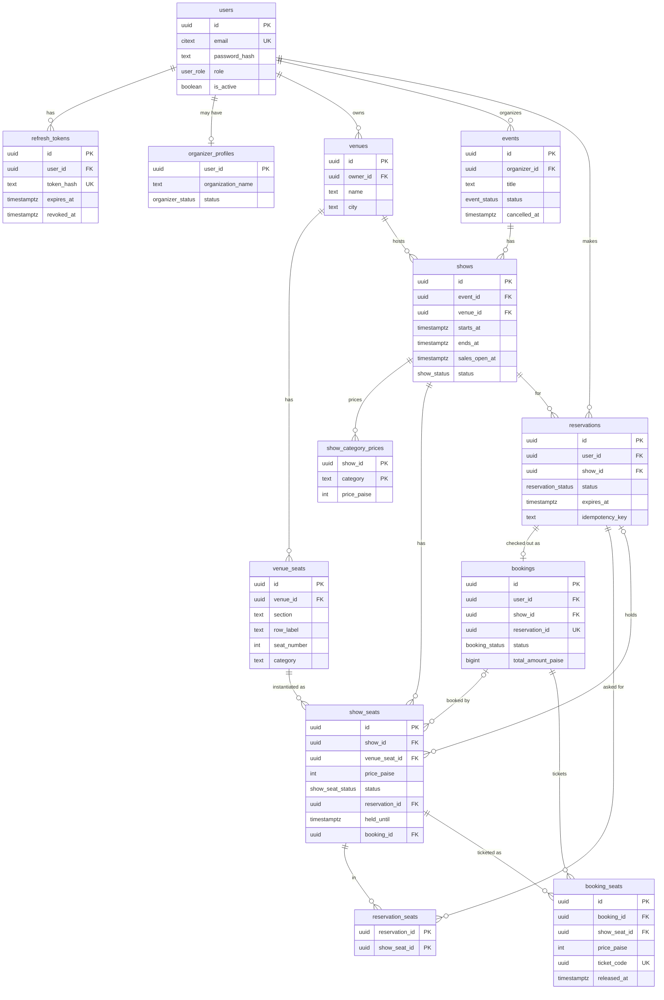

# Data model

Thirteen tables in two migrations:

- `migrations/1790783907036_phase1-foundation.sql`: users, tokens, organizers, venues, events, shows, prices
- `migrations/1792003061254_phase2-booking-engine.sql`: reservations, bookings, seats, tickets

All ids are `uuid` (`gen_random_uuid()`), all timestamps are `timestamptz`, and money is an
integer number of **paise**. Tables with `updated_at` keep it current with a
`set_updated_at()` trigger. Extensions: `citext` (case-insensitive email) and `btree_gist`
(for the venue-overlap exclusion constraint).

## ER diagram

Enums:

- `user_role`: ATTENDEE, ORGANIZER, ADMIN
- `organizer_status`: PENDING, APPROVED, REJECTED
- `event_status`: DRAFT, PUBLISHED, CANCELLED
- `show_status`: SCHEDULED, CANCELLED, COMPLETED
- `show_seat_status`: AVAILABLE, HELD, BOOKED, BLOCKED
- `reservation_status`: ACTIVE, CONFIRMED, EXPIRED, RELEASED
- `booking_status`: PENDING_PAYMENT, CONFIRMED, PAYMENT_FAILED, EXPIRED, CANCELLED, REFUND_PENDING, REFUNDED

## Tables

### `users`

Accounts. `email` is `citext UNIQUE`, so `A@x.com` and `a@x.com` are the same account. Two
concurrent registrations with one email can both pass the service's pre-check; the loser hits
`23505` on `users_email_key`, which `auth.service.ts` maps to the same 409 `EMAIL_TAKEN` as
the pre-check (`tests/robustness.test.ts` E: 10 parallel registers give 1x201 and 9x409).
`CHECK (length(trim(name)) > 0)` rejects blank names. `role` can only be ATTENDEE or
ORGANIZER at registration (Zod); ADMIN is unused. `is_active=false` makes login and refresh
fail with the same 401 as a wrong password; nothing in the API sets it yet.

### `refresh_tokens`

Only the SHA-256 `token_hash` (UNIQUE) is stored, never the token, so a database leak gives
no usable refresh tokens. `expires_at` is set with the DB clock
(`now() + make_interval(days => N)`). Rotation sets `revoked_at`; presenting a revoked token
revokes all of that user's tokens. `ON DELETE CASCADE` from users.

### `organizer_profiles`

One row per organizer (`user_id` PK). `status` defaults to `APPROVED`. The migration notes
it will change to `PENDING` once an admin approval flow exists.

### `venues` and `venue_seats`

Venues belong to an organizer (`owner_id`). Capacity is not stored; it is
`COUNT(venue_seats)`, so there is no copy to go stale. `venue_seats` is the physical layout,
reused by every show at the venue. General admission is one section with row `G` and seats
1..N.

- `UNIQUE (venue_id, section, row_label, seat_number)` stops the same physical seat being
  created twice. A repeated bulk call maps it to 409 `SEATS_ALREADY_EXIST`.
- `CHECK (seat_number > 0)`.
- Bulk calls lock the venue row `FOR UPDATE`, so parallel calls cannot race past
  `MAX_SEATS_PER_VENUE` (`tests/api-consistency.test.ts` M-5).

### `events`

Created as `DRAFT`. Publishing moves DRAFT to PUBLISHED, and only when at least one show
exists; cancelling moves either to CANCELLED with `cancelled_at`. DRAFT events and their
shows are invisible to public reads (404).

### `shows`

One event has many shows; the venue belongs to the show.

- `CHECK (ends_at > starts_at)`.
- **`no_venue_overlap`**:
  `EXCLUDE USING gist (venue_id WITH =, tstzrange(starts_at, ends_at) WITH &&) WHERE (status <> 'CANCELLED')`.
  Two live shows can never overlap in the same venue, even when created concurrently. It
  maps to 409. Under parallel inserts, Postgres can deadlock while checking an exclusion
  constraint (`40P01`), so `createShow` first takes a per-venue advisory lock
  (`pg_advisory_xact_lock(hashtext(venueId))`). `tests/robustness.test.ts` F runs 50 rounds
  of two parallel overlapping creates and expects 1x201 + 1x409 with zero 5xx.
- `sales_open_at` (nullable) gates holds; `starts_at > now()` gates holds, checkout and
  confirm.

### `show_category_prices`

Price per seat category for a show; primary key `(show_id, category)`, `price_paise >= 0`.
Show creation requires a price for every category the venue has, and rejects unknown ones
(400).

### `show_seats`

The hot table: one row per (show, physical seat), generated when the show is created, with
`price_paise` copied from the category price at that moment. A later price change cannot
alter seats already on sale.

| Constraint | Rule | Bug it prevents |
|---|---|---|
| `UNIQUE (show_id, venue_seat_id)` | one row per physical seat per show | the same seat sold through two rows |
| `FOREIGN KEY (reservation_id, show_id) REFERENCES reservations(id, show_id)` | a hold must belong to a reservation for the **same** show | a reservation for show A holding a seat of show B |
| `FOREIGN KEY (booking_id, show_id) REFERENCES bookings(id, show_id)` | same for bookings | a booking ticketing another show's seat |
| `chk_show_seat_hold` | `HELD` exactly when `reservation_id` and `held_until` are both set | a HELD seat with no owner or no deadline (never freed), or a free seat still pointing at an old hold |
| `chk_show_seat_booked` | `BOOKED` exactly when `booking_id` is set | a BOOKED seat with no booking, or a booking reference on an unsold seat |
| `CHECK (price_paise >= 0)` | | negative prices |

Indexes: `(show_id, status)`; `(held_until) WHERE status='HELD'`;
`(reservation_id) WHERE reservation_id IS NOT NULL`.

### `reservations`

A user's temporary hold.

| Constraint | Rule | Bug it prevents |
|---|---|---|
| `UNIQUE (user_id, idempotency_key)` | one reservation per key per user | a retried hold creating a second hold |
| `uq_one_active_reservation`: `UNIQUE (user_id, show_id) WHERE status = 'ACTIVE'` | at most one live hold per user per show | one user hoarding seats with many parallel holds; the app expires the user's stale holds in the same transaction before inserting |
| `UNIQUE (id, show_id)` | target for the composite FKs | – |

`expires_at` is set with the DB clock. Index: `(expires_at) WHERE status='ACTIVE'`, used by
the sweeper.

### `reservation_seats`

Which seats a reservation asked for, kept as history after the seats are freed. Primary key
`(reservation_id, show_seat_id)`. Checkout and confirm compare the count of seats still held
against this list, so a partially taken-over hold fails with `HOLD_LOST`.

### `bookings`

Created at checkout as `PENDING_PAYMENT`.

| Constraint | Rule | Bug it prevents |
|---|---|---|
| `reservation_id UNIQUE` | one booking per reservation | a double-clicked checkout creating two bookings for one hold |
| `FOREIGN KEY (reservation_id, show_id) REFERENCES reservations(id, show_id)` | booking and reservation are for the same show | a booking pointing at another show's hold |
| `UNIQUE (id, show_id)` | target for `show_seats.booking_id` FK | – |
| `CHECK (total_amount_paise >= 0)` | | negative totals |

Indexes: `(user_id, created_at DESC)` for "my bookings"; `(show_id, status)`.

### `booking_seats`

The tickets: one row per seat, inserted only when a booking is confirmed.

| Constraint | Rule | Bug it prevents |
|---|---|---|
| **`uq_one_live_ticket_per_seat`**: `UNIQUE (show_seat_id) WHERE released_at IS NULL` | at most one live ticket per seat | **double-selling**, even if every lock and check above failed. The migration calls it the final safety net. |
| `ticket_code UNIQUE` | | two tickets with the same code |
| `UNIQUE (booking_id, show_seat_id)` | | one booking ticketing a seat twice |
| `CHECK (price_paise >= 0)` | | negative prices |

`released_at` is meant to be set on refund so the seat can be sold again; nothing sets it
yet. `checked_in_at` is unused.

## Invariants not expressible as constraints

Nine cross-table rules are checked by query instead: by `scripts/check-invariants.sql`
(`npm run db:check-invariants`) and by `INVARIANT_QUERIES` in `tests/helpers.ts`, which the
concurrency, robustness and sweeper suites assert return zero rows. A healthy database returns zero
rows for each:

1. Every BOOKED seat has exactly one live ticket.
2. Every live ticket's seat is BOOKED by that same booking.
3. Every HELD seat has a reservation that is not RELEASED or CONFIRMED; a HELD seat whose
   deadline is in the future belongs to an ACTIVE reservation.
4. Every CONFIRMED booking's live tickets add up to its total, and their count matches its
   reservation's seats.
5. Every BOOKED seat's booking is CONFIRMED or REFUND_PENDING.
6. Every CONFIRMED reservation has a CONFIRMED or REFUND_PENDING booking.
7. No HELD seat on a CANCELLED show.
8. No ACTIVE reservation on a CANCELLED show.
9. No PENDING_PAYMENT booking on a CANCELLED show.

`scripts/check-sweeper-invariants.sql` (`npm run db:check-sweeper-invariants`) adds three
sweeper-specific checks.

`scripts/verify-002.sql` (`npm run db:verify-002`) inserts invalid rows on purpose, inside
one transaction that is rolled back, to prove the booking-engine constraints reject them.
All 8 cases passed (last verified 2026-10-30):

| # | Invalid row | Rejected by |
|---|---|---|
| 1 | `show_seats` HELD with `reservation_id` NULL | `chk_show_seat_hold` |
| 2 | `show_seats` AVAILABLE with `held_until` set | `chk_show_seat_hold` |
| 3 | `show_seats` BOOKED with `booking_id` NULL | `chk_show_seat_booked` |
| 4 | a seat of show A pointing at a reservation of show B | composite FK `(reservation_id, show_id)` |
| 5 | two live tickets for one seat | `uq_one_live_ticket_per_seat` |
| 6 | (positive case) re-selling a seat after its ticket is released | allowed, as intended |
| 7 | two ACTIVE reservations for one user and show | `uq_one_active_reservation` |
| 8 | two reservations with one user and idempotency key | `UNIQUE (user_id, idempotency_key)` |
